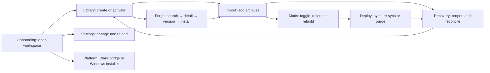
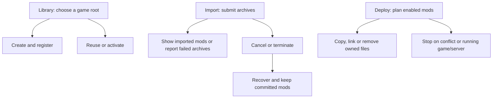

# User-path coverage

A path describes what the user does from a given state and what must happen. A
Go statement percentage cannot tell us whether the app keeps completed imports
after cancellation, or whether it recovers when a process dies during an upgrade.

The [path model](e2e/paths/model.ts) groups journeys by area. Each area has three
axes: **scenario** (the user action), **context** (the precondition) and
**surface** (where the action runs). The generator covers every feasible pair
within each area. It uses each scenario's allowed contexts and surfaces and
applies its explicit exclusions. For example, a mock cannot inspect a real
running game, and a fresh import has no prior version snapshot. We do not pair
unrelated actions from different areas or run every possible triple.

The matrix shows what we **model** and what tests **assert**. An asserted pair
appears in at least one `covered` path. A `partial` path has an exact test
reference, but its note explains what the test does not prove. An `uncovered`
path has no test claim. Windows host rows are open gaps: Linux symlinks, fake
process inspectors and static package checks do not prove the Windows behavior.
See [PARITY_MATRIX.md](PARITY_MATRIX.md) for Rust-to-Go test parity.

| Tier | What it verifies                                                                           |
| ---- | ------------------------------------------------------------------------------------------ |
| T1   | In-process Go API/service behavior, including small fixtures. No UI or native runtime.     |
| T2   | Real filesystem outcomes and process interruption, from a disk fixture or a child process. |
| T3   | Native Wails UI/runtime, OS integration and installer behavior on the specified host.      |
| T4   | Browser UI and command/event plumbing with a mock. No real filesystem or native IPC.       |

The T4 typed-path tests verify library creation by its new tab and archive
submission by the exact command arguments. The T3 native command builds and
launches the Wails app under Xvfb. Its query-gated page calls the bound
`CreateLibrary`, `InstallModArchives`, and `CancelTask` commands against a real
Go backend and filesystem. `xdotool` presses a focused smoke button, and the
test checks a screenshot pixel plus the resulting status text reported to Go.
This proves a painted WebKitGTK window, real IPC, archive filesystem outcomes,
and one keyboard-driven interaction. Its 25-archive check uses aggregate counts
and selected boundary files; it does not verify every row. It does not prove
normal onboarding or import screens, GTK file dialogs, installer behavior, or
Windows behavior. Native create/import journey evidence is therefore partial.
[path parser unit tests](src/redesign/shared/utils/path-input.test.ts) cover
empty and whitespace input, comma and newline separators, duplicates, and
unsupported extensions. Those unit tests do not count as user paths.
The T2 startup test reopens a registered library through
`NewAppAt(...).Start()` and proves that startup restores a pending snapshot and
clears stale staging. The sync crash test kills after a real deployment
removal and before the final state commit; a later sync converges and preserves
unrelated game data. Purge crash coverage is partial: it proves the quarantine
boundary and external-target protection, but a retained purge journal blocks
retry until explicit recovery is implemented.
Install recovery uses a versioned transaction marker with `prepared` and
`committed` phases. It records both manifest entries. Recovery rolls back files
and manifest membership for `prepared`, and reconciles the new entry for
`committed`. Cleanup removes the marker before the snapshot. If interrupted in
that final window, startup treats the remaining snapshot as disposable and
keeps the already reconciled destination and manifest. SIGKILL tests cover
post-replacement rollback, post-manifest-persist rollback, and repeated startup
after marker removal. Incomplete or legacy markers fail closed rather than
guessing metadata. The guarantee covers process termination, including SIGKILL,
not power loss or storage-device failure; copied mod files and manifest temp
files are not all fsynced.
The browser tool executable picker has no automated user-path test.

## Journey spine



The core state changes have these branches:



## Select paths for a change

```sh
bun run test:paths
bun scripts/test-paths.ts select --changed HEAD
bun scripts/test-paths.ts select --area import
bun scripts/test-paths.ts list --area import --tier T2 --status uncovered
```

`--changed` compares the working tree (including staged changes and non-ignored
untracked files) to `HEAD` or the given Git ref. Use a base commit or branch to
include committed changes. Every matching source glob adds its area. Shared
runtime, binding and harness files select all areas. An unmapped app or
Playwright file also selects all areas; other unmatched files select only the
smoke spine. `--area` selects one area without Git. Both modes always include
the smoke spine: workspace render, first sync and the native bridge.

The selector prints commands. It does not run them or mark gaps as covered.
Commands deduplicate exact test names per Go package or Playwright spec. Set
`PLAYWRIGHT_CHROMIUM_EXECUTABLE` only to override Playwright's Chromium. The
Linux native smoke command requires the Nix development shell and Xvfb. The
catalog, selector and guard work offline; individual test environments have
their own prerequisites.

## Add or update a path

1. Add the action, its expected outcome and eligible contexts to the matching
   journey file in [`e2e/paths/`](e2e/paths/). Use a narrower surface list or an
   exclusion with a reason when a combination is not applicable.
2. Add a record in [`evidence.ts`](e2e/paths/evidence.ts) to pin a specific
   `<area>.<scenario>.<context>.<surface>` path. Use `covered` only if the named
   test asserts the expected outcome for that context and surface. Use
   `partial` and describe what is missing otherwise. Pin high-risk gaps in
   priority order.
3. Update change globs when the area gains a new source or test entry point.
4. Regenerate the matrix and run the guard:

   ```sh
   bun scripts/test-paths.ts matrix --write
   bun run paths:check
   ```

The guard checks for duplicate IDs, unused dimension values, missing test
declarations and a stale matrix. It cannot tell whether a test still asserts
the right behavior: check that when you review changes to test code. Use
`--json` for scripts. `bun scripts/test-paths.ts model --json` exports the
authored model; `matrix --json` exports the generated catalog and pair counts.

<!-- prettier-ignore-start -->
<!-- TEST-PATHS:START -->

## Coverage summary

| Area | Paths | Covered | Partial | Uncovered | Modeled / feasible pairs | Asserted pairs | Excluded pairs |
| --- | ---: | ---: | ---: | ---: | ---: | ---: | ---: |
| onboarding | 11 | 5 | 0 | 6 | 27 / 27 | 14 | 38 |
| library | 26 | 11 | 2 | 13 | 55 / 55 | 27 | 117 |
| import | 33 | 7 | 8 | 18 | 71 / 71 | 19 | 153 |
| mod | 18 | 3 | 4 | 11 | 36 / 36 | 8 | 47 |
| deploy | 21 | 8 | 2 | 11 | 47 / 47 | 22 | 120 |
| forge | 17 | 8 | 1 | 8 | 36 / 36 | 21 | 69 |
| settings | 14 | 6 | 0 | 8 | 28 / 28 | 15 | 17 |
| recovery | 11 | 5 | 1 | 5 | 28 / 28 | 15 | 35 |
| platform | 7 | 1 | 1 | 5 | 18 / 18 | 3 | 29 |
| **Total** | 158 | 54 | 19 | 85 | 346 / 346 | 144 | 625 |

## Highest-risk uncovered paths

1. `library.delete-deployed.deployed-library.native-windows` — Delete with real Windows links and verify only owned game files are removed.
2. `deploy.game-running.running-executable.native-windows` — Launch a real game executable and prove sync stops before any write.
3. `deploy.server-running.running-executable.native-windows` — Launch a real SPT server executable and prove sync stops before any write.
4. `deploy.link-mode.shared-game-tree.native-windows` — Use real Windows link and junction fixtures, not Linux symlinks.
5. `platform.installer.previous-version.native-windows` — Upgrade a real Windows install and verify that existing preferences and libraries survive.
6. `platform.installer.clean-windows.native-windows` — Start the installed release on a clean Windows host.
7. `platform.webview2.prerequisite-missing.native-windows` — Start on a Windows host without WebView2 and verify actionable guidance.

## Path matrix

★ marks the smoke spine. † requires a Windows host.

### onboarding

| Path ID | Tier | Status | Expected outcome | Evidence or gap |
| --- | --- | --- | --- | --- |
| `onboarding.corrupt-config.invalid-file.backend-api` | T1 | covered | The parse failure does not overwrite the original file | `backend/registry :: TestCorruptConfigPreservedAndFailedSaveDoesNotMutate` |
| `onboarding.corrupt-config.invalid-file.native-linux` | T3 | uncovered | The parse failure does not overwrite the original file | — |
| `onboarding.empty-config.first-launch.backend-api` | T1 | covered | Default settings load | `backend/store :: TestTestLoadMissingFileYieldsDefault` |
| `onboarding.empty-config.first-launch.native-linux` | T3 | uncovered | Default settings load | — |
| `onboarding.existing-config.saved-workspace.browser-mock` ★ | T4 | covered | The saved active workspace and its mods appear | `e2e/playwright/mock-workflows.spec.ts :: workspace renders fixture library and mods` |
| `onboarding.existing-config.saved-workspace.linux-process` | T2 | covered | The saved active workspace and its mods appear | `backend :: TestInstallProcessT2Journey` |
| `onboarding.existing-config.saved-workspace.native-linux` | T3 | uncovered | The saved active workspace and its mods appear | — |
| `onboarding.multiple-libraries.saved-pair.browser-mock` | T4 | uncovered | The chosen workspace appears without changing the other library | — |
| `onboarding.multiple-libraries.saved-pair.native-linux` | T3 | uncovered | The chosen workspace appears without changing the other library | — |
| `onboarding.unsupported-spt.configured-library.backend-api` | T1 | covered | Activation fails | `backend/library :: TestTestActivateUnsupportedSptVersionFailsOnlyOnActivate` |
| `onboarding.unsupported-spt.configured-library.native-linux` | T3 | uncovered | Activation fails | — |

### library

| Path ID | Tier | Status | Expected outcome | Evidence or gap |
| --- | --- | --- | --- | --- |
| `library.activate.inactive-library.backend-api` | T1 | covered | It becomes the active library | `backend/library :: TestTestActivateLibraryById`<br>`backend/library :: TestActivateInactiveLibraryRecoversInterruptedInstall` |
| `library.activate.inactive-library.browser-mock` | T4 | partial | It becomes the active library | `e2e/playwright/mock-workflows.spec.ts :: create library and activate it`<br>The activation button changes state for a seeded library; the spec does not verify the resulting workspace. |
| `library.create-custom-root.first-launch.backend-api` | T1 | covered | The new library opens | `backend :: TestAppSurfaceEndToEnd` |
| `library.create-custom-root.first-launch.browser-mock` | T4 | uncovered | The new library opens | The typed-path spec enters a game root, not a custom library root. |
| `library.create-custom-root.first-launch.native-linux` | T3 | partial | The new library opens | `scripts/native-t3.sh :: PASS native backend archive journeys`<br>A query-gated test panel calls CreateLibrary directly. The run proves real Wails IPC and filesystem setup, not product onboarding or the native folder picker. |
| `library.create-custom-root.first-launch.wails-dev` | T3 | uncovered | The new library opens | — |
| `library.create-default-root.existing-root.backend-api` | T1 | covered | The registered library opens and reuses a valid library if present | `backend/library :: TestTestCreateLibraryAdoptsExistingId` |
| `library.create-default-root.first-launch.backend-api` | T1 | covered | The registered library opens and reuses a valid library if present | `backend/library :: TestTestCreateLibraryRegistersAndActivates` |
| `library.create-default-root.first-launch.browser-mock` | T4 | uncovered | The registered library opens and reuses a valid library if present | — |
| `library.create-from-typed-game-root.active-library.browser-mock` | T4 | covered | The new library tab shows the name derived from the entered game root | `e2e/playwright/mock-workflows.spec.ts :: create library and activate it` |
| `library.cross-major.major-changed.backend-api` | T1 | covered | A major-specific library opens and the old library root remains | `backend/library :: TestDefaultLibraryRootMovesToAVersionedRootAfterAnSptMajorChange` |
| `library.cross-major.major-changed.native-linux` | T3 | uncovered | A major-specific library opens and the old library root remains | — |
| `library.cross-major.major-changed.native-windows` | T3 † | uncovered | A major-specific library opens and the old library root remains | — |
| `library.delete-deployed.deployed-library.backend-filesystem` | T2 | uncovered | Owned artifacts are removed and unrelated game files survive | — |
| `library.delete-deployed.deployed-library.native-linux` | T3 | uncovered | Owned artifacts are removed and unrelated game files survive | — |
| `library.delete-deployed.deployed-library.native-windows` | T3 † | uncovered | Owned artifacts are removed and unrelated game files survive | Delete with real Windows links and verify only owned game files are removed. |
| `library.delete-files.active-library.backend-api` | T1 | covered | On success the root is removed; on save failure the entry and files remain | `backend/library :: TestTestDeleteLibraryFilesRemovesDirectory` |
| `library.delete-files.active-library.backend-filesystem` | T2 | uncovered | On success the root is removed; on save failure the entry and files remain | — |
| `library.delete-files.config-write-fails.backend-filesystem` | T2 | covered | On success the root is removed; on save failure the entry and files remain | `backend/library :: TestDeletingALibraryKeepsFilesWhenConfigSaveFails` |
| `library.delete-files.inactive-library.backend-filesystem` | T2 | uncovered | On success the root is removed; on save failure the entry and files remain | — |
| `library.delete-keep-files.active-library.backend-api` | T1 | covered | The library files remain | `backend/library :: TestTestDeleteLibraryEntryKeepsFiles` |
| `library.delete-keep-files.active-library.native-linux` | T3 | uncovered | The library files remain | — |
| `library.rename.active-library.backend-api` | T1 | covered | The new name is stored without switching libraries | `backend/library :: TestTestRenameLibraryActiveAndInactive` |
| `library.rename.active-library.browser-mock` | T4 | uncovered | The new name is stored without switching libraries | — |
| `library.rename.inactive-library.backend-api` | T1 | covered | The new name is stored without switching libraries | `backend/library :: TestTestRenameLibraryActiveAndInactive` |
| `library.tool-executable.active-library.browser-mock` | T4 | uncovered | The library shows the new tool with the supplied executable path | The tool picker shares the path dialog, but no browser test saves and verifies a tool. |

### import

| Path ID | Tier | Status | Expected outcome | Evidence or gap |
| --- | --- | --- | --- | --- |
| `import.cancel-mid-batch.new-batch.backend-filesystem` | T2 | covered | The task reports cancellation, keeps committed mods, and can import again | `backend :: TestCancelInstallBatchCommitsCompletedArchives` |
| `import.cancel-mid-batch.new-batch.browser-mock` | T4 | partial | The task reports cancellation, keeps committed mods, and can import again | `e2e/playwright/task-center.spec.ts :: running install task exposes a cancel action`<br>The click reaches CancelTask with both IDs; mock cancellation does not verify retained files or a follow-up import. |
| `import.cancel-mid-batch.new-batch.linux-process` | T2 | partial | The task reports cancellation, keeps committed mods, and can import again | `backend :: TestInstallProcessT2Journey`<br>Asserts committed mod count after restart and follow-up import, not the cancellation result event. |
| `import.cancel-mid-batch.new-batch.native-linux` | T3 | partial | The task reports cancellation, keeps committed mods, and can import again | `scripts/native-t3.sh :: PASS native backend archive journeys`<br>The test-only panel calls CancelTask through real Wails IPC and verifies that a partial batch reaches disk. IPC scheduling makes the committed count variable; it does not test the product import screen. |
| `import.duplicate-mod-id.empty-library.backend-api` | T1 | uncovered | Only one mod with that ID remains and the task reports the result | — |
| `import.duplicate-mod-id.populated-library.backend-api` | T1 | uncovered | Only one mod with that ID remains and the task reports the result | — |
| `import.install-on-false.empty-library.backend-api` | T1 | partial | The new mod is disabled | `backend/models :: TestInstallPreferenceAppliesToNewModsAndPreservesUpdates`<br>The model applies the setting, but no archive goes through the full importer with it off. |
| `import.install-on-false.populated-library.browser-mock` | T4 | uncovered | The new mod is disabled | — |
| `import.install-on-true.empty-library.backend-api` | T1 | covered | The new mod is enabled | `backend :: TestAppSurfaceEndToEnd` |
| `import.install-on-true.populated-library.browser-mock` | T4 | uncovered | The new mod is enabled | — |
| `import.kill-fresh-import.populated-library.linux-process` | T2 | covered | Earlier batches remain, temporary files are cleared, and a later import succeeds | `backend :: TestInstallProcessT2Journey` |
| `import.kill-fresh-import.populated-library.native-windows` | T3 † | uncovered | Earlier batches remain, temporary files are cleared, and a later import succeeds | — |
| `import.kill-mid-batch.partly-committed-batch.linux-process` | T2 | uncovered | Only committed members of the interrupted batch remain and a later import succeeds | The process test kills a final one-archive task, not a partly committed task. |
| `import.kill-mid-batch.partly-committed-batch.native-windows` | T3 † | uncovered | Only committed members of the interrupted batch remain and a later import succeeds | — |
| `import.many-25.empty-library.backend-api` | T1 | covered | All 25 mods appear | `backend :: TestInstallManyArchives` |
| `import.many-25.empty-library.linux-process` | T2 | uncovered | All 25 mods appear | — |
| `import.many-25.empty-library.native-linux` | T3 | partial | All 25 mods appear | `scripts/native-t3.sh :: PASS native backend archive journeys`<br>A query-gated panel submits 25 archives through IPC. The test checks aggregate counts and selected boundary files, not all 25 rows or the product import screen. |
| `import.many-25.populated-library.linux-process` | T2 | partial | All 25 mods appear | `backend :: TestInstallProcessT2Journey`<br>Asserts the aggregate count after all batches and restart, not the 25 individual IDs. |
| `import.mixed-valid-invalid.empty-library.backend-api` | T1 | uncovered | The valid mod appears and the invalid path has its own failure | — |
| `import.mixed-valid-invalid.populated-library.native-linux` | T3 | uncovered | The valid mod appears and the invalid path has its own failure | — |
| `import.one-archive.empty-library.backend-api` | T1 | covered | A mod row appears | `backend :: TestAppSurfaceEndToEnd` |
| `import.one-archive.empty-library.browser-mock` | T4 | uncovered | A mod row appears | The typed-path spec submits two archives to a seeded library. It cannot prove extraction or filesystem writes. |
| `import.one-archive.empty-library.native-linux` | T3 | partial | A mod row appears | `scripts/native-t3.sh :: PASS native backend archive journeys`<br>A query-gated test panel calls InstallModArchives directly and checks archive output on disk. It does not exercise the product import screen. |
| `import.one-archive.populated-library.backend-api` | T1 | uncovered | A mod row appears | — |
| `import.permission-error.unwritable-library.backend-filesystem` | T2 | uncovered | An error identifies the rejected archive and existing data survives | — |
| `import.permission-error.unwritable-library.native-linux` | T3 | uncovered | An error identifies the rejected archive and existing data survives | — |
| `import.permission-error.unwritable-library.native-windows` | T3 † | uncovered | An error identifies the rejected archive and existing data survives | — |
| `import.switch-library-during-install.switch-during-install.backend-filesystem` | T2 | uncovered | The task result and files stay associated with the originating library | No integration test switches the active library while an admitted install runs. The install worker still reads the mutable active-library pointer, so library association is not proven. |
| `import.typed-paths.populated-library.browser-mock` | T4 | covered | The install command receives the exact archive paths and a new mock mod row appears | `e2e/playwright/mock-workflows.spec.ts :: archive import accepts typed paths and starts the install flow` |
| `import.unsupported-compression.empty-library.backend-api` | T1 | partial | The archive is rejected without adding a mod or changing existing files | `backend/archive :: TestExtractMalformedAndUnsupportedLeaveDestinationUntouched`<br>Tests the extractor; does not assert the importer result or workspace. |
| `import.unsupported-compression.populated-library.backend-api` | T1 | uncovered | The archive is rejected without adding a mod or changing existing files | — |
| `import.upgrade-same-id.existing-mod.backend-api` | T1 | covered | One row remains, its files are updated, and no snapshot is left | `backend :: TestInstallUpgradeLeavesNoSnapshot` |
| `import.upgrade-same-id.existing-mod.native-linux` | T3 | uncovered | One row remains, its files are updated, and no snapshot is left | — |

### mod

| Path ID | Tier | Status | Expected outcome | Evidence or gap |
| --- | --- | --- | --- | --- |
| `mod.bulk-delete.deployed-mod.backend-api` | T1 | uncovered | The selected mods leave the workspace | — |
| `mod.bulk-delete.selection.backend-api` | T1 | uncovered | The selected mods leave the workspace | — |
| `mod.bulk-delete.single-mod.backend-api` | T1 | partial | The selected mods leave the workspace | `backend/library :: TestTestBulkUpdateDeleteRemovesMod`<br>Checks removal from the library model, not the returned workspace. |
| `mod.bulk-delete.single-mod.browser-mock` | T4 | uncovered | The selected mods leave the workspace | — |
| `mod.bulk-disable.selection.browser-mock` | T4 | partial | The enabled state clears | `e2e/playwright/mock-workflows.spec.ts :: bulk mod actions update enabled state`<br>The server mod becomes disabled; the assertion does not check every selected mod. |
| `mod.bulk-disable.single-mod.backend-api` | T1 | covered | The enabled state clears | `backend :: TestAppSurfaceEndToEnd` |
| `mod.bulk-enable.selection.browser-mock` | T4 | partial | The enabled state updates without deploying | `e2e/playwright/mock-workflows.spec.ts :: bulk mod actions update enabled state`<br>The server mod becomes enabled; the assertion does not check every selected mod. |
| `mod.bulk-enable.single-mod.backend-api` | T1 | covered | The enabled state updates without deploying | `backend/library :: TestTestBulkUpdateSetsStaleAndNeverDeploys`<br>`backend :: TestAppSurfaceEndToEnd` |
| `mod.disable.deployed-mod.backend-api` | T1 | uncovered | Its row becomes disabled | — |
| `mod.disable.single-mod.backend-api` | T1 | uncovered | Its row becomes disabled | — |
| `mod.disable.single-mod.browser-mock` | T4 | uncovered | Its row becomes disabled | — |
| `mod.enable.single-mod.backend-api` | T1 | uncovered | Its row becomes enabled | — |
| `mod.enable.single-mod.browser-mock` | T4 | uncovered | Its row becomes enabled | — |
| `mod.folder-rename.mismatched-folder.backend-filesystem` | T2 | partial | The folder moves to the manifest ID and the old path is gone | `backend/library :: TestTestCacheRebuildRenamesMismatchedFolder`<br>Asserts a real rename through the normalizer, not through a rebuild task. |
| `mod.folder-rename.mismatched-folder.native-linux` | T3 | uncovered | The folder moves to the manifest ID and the old path is gone | — |
| `mod.rebuild-cache.empty-library.backend-api` | T1 | covered | The task reports progress and completion | `backend :: TestAppSurfaceEndToEnd` |
| `mod.rebuild-cache.empty-library.browser-mock` | T4 | uncovered | The task reports progress and completion | — |
| `mod.rebuild-cache.selection.browser-mock` | T4 | uncovered | The task reports progress and completion | — |

### deploy

| Path ID | Tier | Status | Expected outcome | Evidence or gap |
| --- | --- | --- | --- | --- |
| `deploy.collision.shared-game-tree.backend-filesystem` | T2 | covered | Sync rejects the conflict without overwriting user files | `backend/deployment :: TestTestUnownedDeploymentTargetIsPreservedAndBlocksSync` |
| `deploy.collision.shared-game-tree.native-linux` | T3 | uncovered | Sync rejects the conflict without overwriting user files | — |
| `deploy.copy-mode.shared-game-tree.backend-filesystem` | T2 | covered | The app keeps existing game files and does not claim their directory | `backend/deployment :: TestTestCopyDeploymentMergesIntoExistingGameDirectory` |
| `deploy.first-sync.enabled-mod.backend-api` ★ | T1 | covered | The game receives the mod and the task reports success | `backend :: TestAppSurfaceEndToEnd` |
| `deploy.first-sync.enabled-mod.native-linux` | T3 | uncovered | The game receives the mod and the task reports success | — |
| `deploy.game-running.running-executable.native-linux` | T3 | uncovered | Sync is blocked without changing the game tree | — |
| `deploy.game-running.running-executable.native-windows` | T3 † | uncovered | Sync is blocked without changing the game tree | Launch a real game executable and prove sync stops before any write. |
| `deploy.link-mode.shared-game-tree.backend-filesystem` | T2 | covered | Links can share a game folder without replacing the folder | `backend/deployment :: TestTestRecursiveLinkingLogic` |
| `deploy.link-mode.shared-game-tree.native-windows` | T3 † | uncovered | Links can share a game folder without replacing the folder | Use real Windows link and junction fixtures, not Linux symlinks. |
| `deploy.noop-sync.unchanged-plan.backend-filesystem` | T2 | covered | The app retains directory ownership | `backend/deployment :: TestTestCopyDeploymentReusesOwnedDirectoriesAndNormalizesLegacyPaths` |
| `deploy.purge.legacy-links.backend-filesystem` | T2 | partial | Only owned links are removed; external targets are untouched | `backend/deployment :: TestPurgeNeverFollowsExternalDirectoryLinks`<br>`backend/library :: TestCrossMajorMigrationPurgesLegacyLinksFromTheOldServerRoot`<br>Asserts external protection and legacy cleanup in separate fixtures. |
| `deploy.purge.legacy-links.native-linux` | T3 | uncovered | Only owned links are removed; external targets are untouched | — |
| `deploy.purge.legacy-links.native-windows` | T3 † | uncovered | Only owned links are removed; external targets are untouched | — |
| `deploy.server-running.running-executable.native-linux` | T3 | uncovered | Sync is blocked without changing the game tree | — |
| `deploy.server-running.running-executable.native-windows` | T3 † | uncovered | Sync is blocked without changing the game tree | Launch a real SPT server executable and prove sync stops before any write. |
| `deploy.stale.previous-sync.backend-api` | T1 | covered | The old deployment is reported as stale | `backend/deployment :: TestReloadingALibraryRefreshesDeployStale` |
| `deploy.stale.previous-sync.native-linux` | T3 | uncovered | The old deployment is reported as stale | — |
| `deploy.sync-after-toggle.previous-sync.backend-filesystem` | T2 | covered | The deployed copy is removed and the library source remains | `backend/deployment :: TestTestPurgeRemovesDeactivatedMods` |
| `deploy.sync-after-toggle.previous-sync.native-linux` | T3 | uncovered | The deployed copy is removed and the library source remains | — |
| `deploy.sync-after-toggle.shared-game-tree.backend-filesystem` | T2 | partial | The deployed copy is removed and the library source remains | `backend/deployment :: TestTestUntrackedFileSafetyInSharedFolder`<br>Checks deployed removal and surviving game data, but not the source library after sync. |
| `deploy.task-progress.task-progress-fixture.browser-mock` | T4 | covered | The stage, percent, and log are available | `e2e/playwright/task-center.spec.ts :: task center opens and displays progress and its log` |

### forge

| Path ID | Tier | Status | Expected outcome | Evidence or gap |
| --- | --- | --- | --- | --- |
| `forge.detail.active-library.backend-api` | T1 | covered | The selected detail returns its fields, including parent data for an add-on | `backend/forge :: TestModDetailWireUsesCamelCaseAndExplicitNulls` |
| `forge.detail.addon.backend-api` | T1 | covered | The selected detail returns its fields, including parent data for an add-on | `backend/forge :: TestAddonDetailResolvesIncompleteParent` |
| `forge.detail.addon.browser-mock` | T4 | uncovered | The selected detail returns its fields, including parent data for an add-on | — |
| `forge.download.fresh-response.backend-filesystem` | T2 | covered | Valid bytes reach the importer; on verification failure no generated archive remains | `backend/forge :: TestDownloadWritesBytesAndReportsProgressWithoutTouchingSourceArchive` |
| `forge.download.size-mismatch.backend-filesystem` | T2 | covered | Valid bytes reach the importer; on verification failure no generated archive remains | `backend/forge :: TestDownloadSizeMismatchRemovesGeneratedArchive` |
| `forge.install.fresh-response.backend-api` | T1 | uncovered | A fresh version appears in the library with Forge identity; stale metadata cannot install | — |
| `forge.install.fresh-response.native-linux` | T3 | uncovered | A fresh version appears in the library with Forge identity; stale metadata cannot install | — |
| `forge.install.stale-metadata.backend-api` | T1 | partial | A fresh version appears in the library with Forge identity; stale metadata cannot install | `backend/forge :: TestStaleMetadataCannotInstallOrMatch`<br>The metadata resolver rejects stale data; this does not drive the install task. |
| `forge.install.stale-metadata.native-linux` | T3 | uncovered | A fresh version appears in the library with Forge identity; stale metadata cannot install | — |
| `forge.rate-limit.rate-limited.backend-api` | T1 | covered | The client blocks the retry during the wait window | `backend/forge :: TestRateLimitRetryAfterBlocksRequests` |
| `forge.rate-limit.rate-limited.browser-mock` | T4 | uncovered | The client blocks the retry during the wait window | — |
| `forge.search-empty.active-library.backend-api` | T1 | uncovered | An empty state is shown | — |
| `forge.search-empty.active-library.browser-mock` | T4 | covered | An empty state is shown | `e2e/playwright/mock-workflows.spec.ts :: forge search has fixture results and empty state` |
| `forge.search-results.active-library.backend-api` | T1 | uncovered | The matching result is shown | — |
| `forge.search-results.active-library.browser-mock` | T4 | covered | The matching result is shown | `e2e/playwright/mock-workflows.spec.ts :: forge search has fixture results and empty state` |
| `forge.versions.active-library.backend-api` | T1 | uncovered | The version is available even when it is not on the first API page | — |
| `forge.versions.later-page.backend-api` | T1 | covered | The version is available even when it is not on the first API page | `backend/forge :: TestFindVersionReadsLaterPagesAndCapsAt100` |

### settings

| Path ID | Tier | Status | Expected outcome | Evidence or gap |
| --- | --- | --- | --- | --- |
| `settings.accent.after-reload.backend-api` | T1 | covered | The selected accent is retained | `backend/registry :: TestConfigStoreRoundTripAndLegacyDefaults` |
| `settings.accent.after-reload.browser-mock` | T4 | uncovered | The selected accent is retained | The settings Playwright title mentions accent, but the test only asserts Dark after reload. |
| `settings.install-on.after-reload.backend-api` | T1 | covered | The setting is still off | `backend/registry :: TestConfigStoreRoundTripAndLegacyDefaults` |
| `settings.install-on.after-reload.browser-mock` | T4 | uncovered | The setting is still off | — |
| `settings.language.after-reload.backend-api` | T1 | uncovered | The chosen language is used | — |
| `settings.language.after-reload.browser-mock` | T4 | uncovered | The chosen language is used | — |
| `settings.migration-warning.legacy-config.browser-mock` | T4 | uncovered | The app surfaces the warning without silently replacing saved settings | — |
| `settings.migration-warning.legacy-config.native-linux` | T3 | uncovered | The app surfaces the warning without silently replacing saved settings | — |
| `settings.persistence.after-reload.backend-api` | T1 | covered | Previously saved values are loaded | `backend/registry :: TestConfigStoreRoundTripAndLegacyDefaults` |
| `settings.persistence.after-reload.native-linux` | T3 | uncovered | Previously saved values are loaded | — |
| `settings.persistence.legacy-config.backend-api` | T1 | covered | Previously saved values are loaded | `backend/registry :: TestConfigStoreRoundTripAndLegacyDefaults` |
| `settings.theme.after-reload.browser-mock` | T4 | covered | Dark is selected | `e2e/playwright/mock-workflows.spec.ts :: settings theme and accent persist after reload` |
| `settings.theme.open-settings.backend-api` | T1 | covered | Dark is selected | `backend :: TestAppSurfaceEndToEnd` |
| `settings.theme.open-settings.browser-mock` | T4 | uncovered | Dark is selected | — |

### recovery

| Path ID | Tier | Status | Expected outcome | Evidence or gap |
| --- | --- | --- | --- | --- |
| `recovery.crash-import-fresh.fresh-temp.linux-process` | T2 | covered | Uncommitted files disappear and earlier commits survive | `backend :: TestInstallProcessT2Journey`<br>`backend/library :: TestCrashAfterFreshInstallReplacementRemovesFilesAndManifestEntry` |
| `recovery.crash-import-fresh.fresh-temp.native-windows` | T3 † | uncovered | Uncommitted files disappear and earlier commits survive | — |
| `recovery.crash-import-upgrade.snapshot-fixture.backend-filesystem` | T2 | covered | The prior content is restored when its pending snapshot exists | `backend :: TestStartRecoversInterruptedInstallArtifacts`<br>`backend/library :: TestCommittedRecoveryPreservesSnapshotWhenDestinationIsUnavailable` |
| `recovery.crash-import-upgrade.upgrade-in-flight.linux-process` | T2 | covered | The prior content is restored when its pending snapshot exists | `backend :: TestInstallProcessT2UpgradeJourney`<br>`backend/library :: TestCrashAfterInstallManifestPersistRollsBackFilesAndMetadata`<br>`backend/library :: TestCrashDuringInstallRecoveryCleanupIsIdempotent`<br>`backend/library :: TestCrashAfterCommittedMarkerKeepsUpgradeOnTwoRestarts` |
| `recovery.crash-import-upgrade.upgrade-in-flight.native-windows` | T3 † | uncovered | The prior content is restored when its pending snapshot exists | — |
| `recovery.crash-purge.mid-quarantine.linux-process` | T2 | partial | Owned artifacts are reconciled and external data survives | `backend :: TestPurgeProcessT2CrashAfterQuarantine`<br>Kills after an owned link is moved, verifies the journal remains, then starts a new app and retries delete. The app returns the specific retained-journal refusal and preserves the external target; no recovery reconciles the quarantine. |
| `recovery.crash-purge.mid-quarantine.native-windows` | T3 † | uncovered | Owned artifacts are reconciled and external data survives | — |
| `recovery.crash-sync.mid-deployment.linux-process` | T2 | covered | The manifest and game files converge without losing unrelated files | `backend :: TestSyncProcessT2CrashAfterMutation` |
| `recovery.crash-sync.mid-deployment.native-windows` | T3 † | uncovered | The manifest and game files converge without losing unrelated files | — |
| `recovery.stale-staging.abandoned-staging.backend-filesystem` | T2 | covered | Stale work is cleared without removing user directories | `backend :: TestStartRecoversInterruptedInstallArtifacts` |
| `recovery.stale-staging.abandoned-staging.native-windows` | T3 † | uncovered | Stale work is cleared without removing user directories | — |

### platform

| Path ID | Tier | Status | Expected outcome | Evidence or gap |
| --- | --- | --- | --- | --- |
| `platform.installer.clean-windows.native-windows` | T3 † | uncovered | The installed app launches and preserves user libraries on upgrade | Start the installed release on a clean Windows host. |
| `platform.installer.previous-version.native-windows` | T3 † | uncovered | The installed app launches and preserves user libraries on upgrade | Upgrade a real Windows install and verify that existing preferences and libraries survive. |
| `platform.native-bridge.registered-event.native-linux` ★ | T3 | covered | The settings value round-trips and the frontend sees the Go event | `scripts/native-smoke.sh :: PASS settings JS→Go→JS value`<br>`scripts/native-smoke.sh :: PASS frontend event listener ready`<br>`scripts/native-smoke.sh :: PASS Go emitted registered event`<br>`scripts/native-smoke.sh :: PASS event payload observed by frontend and reported to Go` |
| `platform.native-bridge.registered-event.native-windows` | T3 † | uncovered | The settings value round-trips and the frontend sees the Go event | — |
| `platform.native-bridge.registered-event.wails-dev` | T3 | uncovered | The settings value round-trips and the frontend sees the Go event | — |
| `platform.native-ui.native-smoke-window.native-linux` | T3 | partial | The painted window shows the post-interaction status surface | `scripts/native-t3.sh :: PASS xdotool-driven native UI interaction`<br>A test-only panel receives keyboard input and its status surface is screenshot-checked. This proves a painted native window and keyboard delivery, not a product workflow or native file-dialog test. |
| `platform.webview2.prerequisite-missing.native-windows` | T3 † | uncovered | Modkeeper gives actionable prerequisite guidance | Start on a Windows host without WebView2 and verify actionable guidance. |

<!-- TEST-PATHS:END -->
<!-- prettier-ignore-end -->
